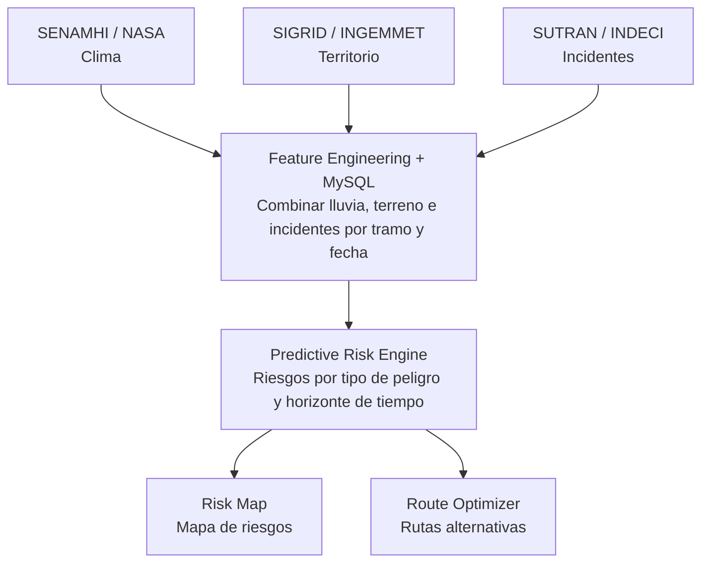

# ILLAPA — Predictive Risk Engine

## Overview

Motor de inteligencia geoespacial diseñado para estimar riesgos de desastres naturales que puedan afectar la infraestructura vial y las cadenas de suministro en Perú.

El sistema integra información meteorológica, geográfica e histórica para identificar segmentos de carretera potencialmente vulnerables, generar alertas preventivas y evaluar rutas logísticas alternativas.

## Technical Approach

**1. Data Ingestion**

Integración de datos provenientes de SENAMHI, NASA GPM, INGEMMET, CENEPRED, INDECI, SUTRAN, Open-Meteo y OpenStreetMap.

**2. Geospatial Processing**

Segmentación de carreteras y extracción de variables por ubicación:

- Precipitación histórica y pronosticada.
- Pendiente y características del terreno.
- Susceptibilidad a movimientos en masa.
- Proximidad a cuerpos de agua.
- Eventos históricos y alertas viales.

**3. Predictive Modeling**

Desarrollo progresivo de dos enfoques:

- **Risk Scoring:** sistema heurístico que calcula índices relativos de riesgo mediante variables ambientales.
- **Machine Learning:** clasificación supervisada mediante LightGBM o XGBoost, entrenada con incidentes históricos georreferenciados y validados. Un solo modelo agrupado para todas las rutas, porque la PE-22 tuvo solo 7 tramo-días con eventos de lluvia en 2026. Ventanas de 3 días y validación con rutas que el modelo no vio. Reemplaza al score heurístico solo si lo supera en esas rutas.

Horizonte inicial de evaluación: 24 horas, extensible a 48 y 72 horas.

**4. Risk-Aware Route Optimization**

Integración de resultados predictivos con algoritmos de grafos sobre un grafo vial guardado en MySQL (nodos y aristas generados con OSMnx) para evaluar rutas según distancia, tiempo y exposición estimada al riesgo. Los cierres viales oficiales se incorporan como restricciones. Si el grafo no encuentra una ruta viable, se usan los desvíos oficiales de SUTRAN.

## Architecture

## Technology Stack

| Layer | Technologies |
| --- | --- |
| Data Processing | Python, Pandas, GeoPandas (offline) |
| Machine Learning | LightGBM, XGBoost, Scikit-learn (entrenamiento offline; inferencia en el Worker exportando el modelo a JS con m2cgen) |
| Geospatial Database | MySQL compartido (Hyperdrive) con sus funciones espaciales |
| Backend | Cloudflare Worker (TypeScript, Hono + oRPC) |
| Routing | OSMnx offline para construir el grafo; grafo vial en MySQL; Dijkstra/A* en el Worker (ngraph.path) |
| Visualization | MapLibre GL JS |

## MVP Scope

**Piloto:** Carretera Central, Lima–Huancayo. El modelo se entrena con todas las rutas (las de más datos: PE-3N, PE-5N y PE-5NA) y se aplica al piloto.

**Entregables:**

- Pipeline de ingesta y normalización de información.
- Cálculo de índices de riesgo por segmento vial.
- API para consultar evaluaciones de riesgo.
- Comparación de rutas considerando exposición a peligros.

## Technical Considerations

El sistema es una herramienta de apoyo a decisiones, no un mecanismo de predicción determinista. Los índices heurísticos no representan probabilidades calibradas. Las recomendaciones deben considerar la calidad y actualidad de los datos, la incertidumbre del modelo y las alertas oficiales.
